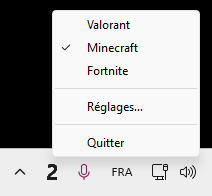
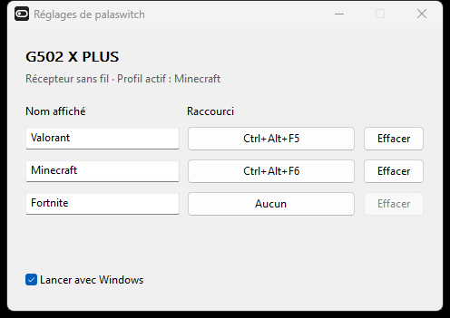

# palaswitch

palaswitch is a Windows tray app that switches the onboard profile of a Logitech gaming mouse, with a click in its menu or a global keyboard shortcut. It talks to the mouse directly over HID++ 2.0 (onboard profiles feature, 0x8100), so neither G HUB nor a script has to run in the background.



Version 1.0.0, maintained by one person. Developed and tested with a G502 X PLUS, wired and through its LIGHTSPEED receiver. Other Logitech mice that keep profiles in onboard memory should work, but none has been tried. Made for Windows 10 and 11, tested on Windows 11.

palaswitch only picks which onboard profile is active. Buttons, DPI, lighting and macros are still set in G HUB or Onboard Memory Manager. Close them while palaswitch runs: they talk to the mouse on the same channel.

## Installation

Download `palaswitch-win-Setup.exe` from the [latest release](https://github.com/Palawizard/palaswitch/releases/latest) and run it. It installs palaswitch for the current user in `%LOCALAPPDATA%\palaswitch`, without administrator rights, adds it to the Start menu and starts it; a notification then says where its icon is.

The installer is not signed, so Windows SmartScreen may stop it with "Windows protected your PC". Click "More info", then "Run anyway". Some antivirus programs may also block the installer or the small launcher it puts in the install folder, for the same reason; if yours does, allow `%LOCALAPPDATA%\palaswitch` in it.

### Updates

About a minute after it starts, then once a day, palaswitch asks GitHub Releases whether a newer version exists. This is the only time it goes online. When there is one, the menu shows "Install version 1.2.0" (with the new number), and so does the settings window. Choosing it downloads the update, closes the app and starts the new version.

### Uninstall

Open Settings > Apps > Installed apps, find palaswitch and choose Uninstall. This removes the app, its logs and its "Start with Windows" entry. Your settings stay in `%APPDATA%\palaswitch`; delete that folder to remove them too.

## Usage

Run `palaswitch.exe`. An icon appears in the notification area with the number of the active profile, or a crossed-out mouse when no mouse answers. Windows may put new icons behind the ^ arrow: drag it onto the taskbar to keep it in sight.

Click the icon to open the menu: it lists the enabled profiles with the active one ticked. Choose a profile to make it active, Settings to open the settings window, or Quit to close the app. A wireless mouse that has not moved for a few minutes goes to sleep and does not answer: move it, then try again. If a change fails, Windows shows a short notification.



The settings window lists the enabled profiles. Give a profile a name to show it in the menu instead of "Profile 1". To give it a keyboard shortcut, click its shortcut field and press the keys, for example Ctrl+Alt+F1; Escape keeps the previous one and Clear removes it. A shortcut needs Ctrl or Alt, except F13 to F24. Win combinations, combinations Windows uses everywhere (Alt+F4, Alt+Space) and Ctrl+Alt combinations that type a character with AltGr on your keyboard (such as @ or € on French keyboards) are refused. If another program already uses a shortcut, the window says so and keeps the previous one. Shortcuts work in full-screen games; games run as administrator are not covered. Changes are saved at once, in `%APPDATA%\palaswitch\settings.toml`. "Start with Windows" starts the app at sign-in, straight into the notification area. Launching the app while it runs opens the settings window.

With two mice with onboard profiles paired to the same receiver, only the first one is used. Only one copy of the app runs at a time. Logs go to `%LOCALAPPDATA%\palaswitch\logs` (at most 2 MB).

The interface follows the Windows display language: French if Windows is in French, English otherwise.

## Development

To build from source on Windows 10 or 11:

1. Install Rust stable with the MSVC toolchain (https://rustup.rs) and the Visual Studio C++ Build Tools.
2. Clone the repository and build:

   ```powershell
   git clone https://github.com/Palawizard/palaswitch.git
   cd palaswitch
   cargo build --release
   ```

The app is `target\release\palaswitch.exe`.

Run every check (format, lint, tests, release build) with:

```powershell
pwsh scripts/verify.ps1
```

The CI runs the same script, then packs the installer.

To build the installer locally, install [vpk](https://docs.velopack.io) (`dotnet tool install -g vpk --version 1.2.161`, needs the .NET 8 SDK), then run:

```powershell
pwsh scripts/pack.ps1
```

The installer and the update packages land in `target\pack\releases`. Pushing a tag such as `v1.0.0`, equal to the version in `Cargo.toml`, builds them in GitHub Actions and uploads them as a draft release. A version with a suffix, such as `1.1.0-rc.1`, becomes a pre-release; an installed pre-release is offered newer pre-releases and stable versions, a stable version only newer stable ones.

To see the interface in the other language without changing the one of Windows, start the app with `PALASWITCH_LANG` set to `fr` or `en`.

The workspace has four crates:

- `palaswitch-hidpp`: the HID++ protocol, with no dependency on Windows or on a HID library, tested against frames captured from a real mouse.
- `palaswitch-device`: finds HID++ devices with hidapi, opens both HID++ collections of each interface and keeps the first device with onboard profiles behind it.
- `palaswitch-cli`: a command line tool for trying the protocol on a connected mouse.
- `palaswitch`: the tray app. All HID++ work runs on its own thread, woken by device changes and incoming reports, never by a timer.

## Command line tool

```powershell
cargo run --release -p palaswitch-cli -- list         # mice, profiles, active profile
cargo run --release -p palaswitch-cli -- get          # active profile
cargo run --release -p palaswitch-cli -- set 2        # make profile 2 active
cargo run --release -p palaswitch-cli -- sniff 10     # print every HID++ report for 10 s
cargo run --release -p palaswitch-cli -- stress 200   # 200 switches between enabled profiles
```

Add `--pid C095` to pick a device by USB product ID, and `-v` for debug logs. `stress` puts the mouse back on the profile it started on, also when stopped with Ctrl+C, and leaves it in onboard mode.

## License

MIT, see [LICENSE](LICENSE).
